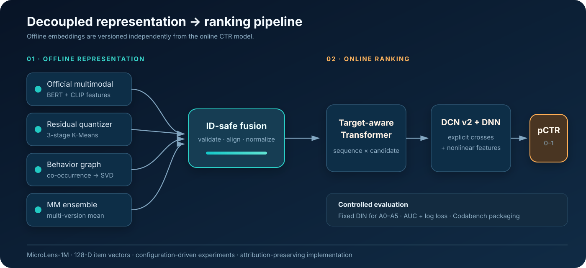
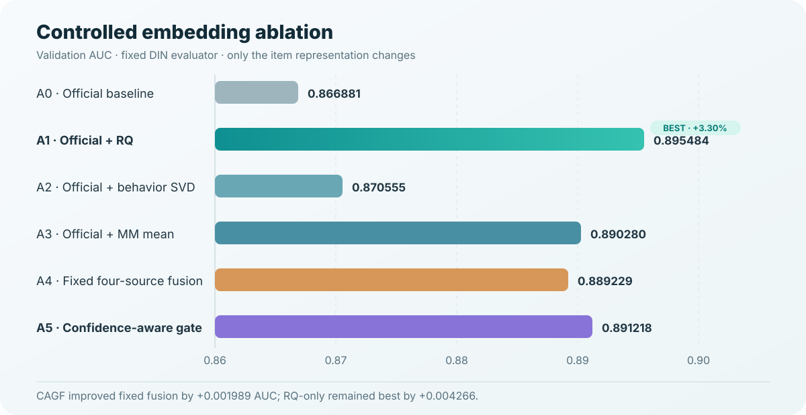

# MMCTR-CAGF

**Confidence-aware multimodal representation learning for decoupled click-through-rate prediction**

Independent reproduction and extension study based on the [WWW 2025 EReL@MIR MM-CTR benchmark](https://erel-mir.github.io/challenge/mmctr-track2/) and the MicroLens-1M dataset.

This project studies a practical recommender-system constraint: expensive item representations are built offline, while a separate neural ranker serves click-through-rate predictions online. I reproduced the official three-track protocol, ran controlled embedding ablations, and designed **Confidence-Aware Gated Fusion (CAGF)**, a label-free gate that learns item-specific source weights without breaking the required stage separation.

> Status: research prototype and course-based independent study. This repository does not claim an official award, competition rank, production deployment, or statistical significance from a single seed.



## Results

| Experiment | Representation | Validation AUC | Interpretation |
|---|---|---:|---|
| A0 | Official embedding | 0.866881 | Controlled local baseline |
| A1 | Official + residual quantization | **0.895484** | Best Task 1 variant; +0.028603 over A0 |
| A4 | Fixed four-source fusion | 0.889229 | More sources did not guarantee a stronger representation |
| A5 | **CAGF** per-item fusion | **0.891218** | +0.001989 over A4; below A1 |
| Cascaded Task 1&2 | Offline representation + Transformer-DCN | **0.9817 test AUC** | Codabench-displayed external result |

Validation and test values come from different splits and are not compared as a direct improvement pair. A5 was evaluated with one retained seed, so its margin over A4 is reported as an observed result rather than a significance claim. The Codabench record is available in [`evidence/codabench_result.png`](evidence/codabench_result.png).



## Original contribution

Fixed fusion assigns the same reliability to every source and item. CAGF replaces that global vector with an offline per-item gate using:

- behavior support;
- residual-quantization reconstruction confidence;
- multimodal-variant agreement;
- missing-source masks;
- cross-source cosine geometry.

The gate is trained with leave-one-source-out reconstruction and never consumes CTR labels or DIN gradients. It therefore produces one materialized 128-dimensional embedding per item before downstream CTR training, preserving the benchmark's decoupled protocol.

On 91,718 items, the retained A5 artifact produced 91,716 distinct weight vectors after four-decimal rounding. Missing sources received exactly zero weight, and all output vectors were finite and L2-normalized. See the [method description](docs/CAGF.md), [diagnostics](evidence/CAGF_DIAGNOSTICS.md), and [case study](docs/PROJECT_CASE_STUDY.md).


## What I implemented

- Behavior co-occurrence graph construction with distance-decayed edges and 128-dimensional Truncated SVD embeddings.
- Multi-stage residual K-Means quantization for embedding reconstruction.
- ID-safe alignment and fusion of official, RQ, behavior, and multimodal sources.
- CAGF training, missing-source masking, per-item diagnostics, and artifact validation.
- A controlled A0-A5 protocol with a fixed DIN evaluator and consistent training configuration.
- Training, prediction, submission, and rule-compliance tooling for Task 1, Task 2, and Task 1&2.
- A dependency-light repository health check and automated GitHub Actions verification.

The fixed DIN evaluator and data loader derive from the official FuxiCTR baseline. The Transformer-DCN ranker is an attributed reproduction of a published Task 2 solution. The ownership boundary is documented in [Evidence and attribution](docs/EVIDENCE_AND_ATTRIBUTION.md).

## Repository map

```text
MMCTR-CAGF/
├── assets/          # Architecture, method, and ablation figures
├── config/          # FuxiCTR and controlled-ablation configurations
├── data/            # Download instructions only; dataset is not redistributed
├── docs/            # Case study, method, workflow, rules, and attribution
├── evidence/        # Compact retained diagnostics and Codabench screenshot
├── results/         # Small machine-readable result summaries
├── scripts/         # Build, train, evaluate, predict, and verification tools
├── src/             # CTR models, data loader, and embedding methods
├── submission/      # Submission format documentation; predictions excluded
└── tests/           # Lightweight checks for features and public packaging
```

## Quick verification

The repository can be checked without the dataset, GPU, PyTorch, or FuxiCTR:

```bash
python3 scripts/project_healthcheck.py
python3 -m unittest discover -s tests -v
```

These commands validate source syntax, required public files, A0-A5 result arithmetic, CAGF diagnostics, attribution language, repository size, and common secret patterns. They do not reproduce GPU training.

## Full reproduction

The original experiments used Python 3.9 and one NVIDIA GPU with at least 16 GB of VRAM. Install the CUDA-compatible PyTorch build for your system, then install the remaining packages:

```bash
conda create -n mmctr python=3.9 -y
conda activate mmctr
pip install -r requirements.txt
```

Download MicroLens-1M following [`data/README.md`](data/README.md), then run:

```bash
python scripts/check_data.py
bash scripts/run_cagf_ablation.sh 0
```

The complete Task 1, Task 2, and cascaded workflow is documented in [`docs/WORKFLOW.md`](docs/WORKFLOW.md). Full training is computationally expensive and is not part of the lightweight CI check.

## Reproducibility and scope

- Dataset files, model checkpoints, prediction rows, and generated embeddings are excluded from Git.
- Small CSV and JSON summaries are retained so reported arithmetic can be checked.
- Upstream baselines and the reproduced ranker are clearly attributed.
- A1 remains the strongest Task 1 representation; CAGF is presented as an original, interpretable extension that improved the fixed-fusion control.
- The next research step is a multi-seed A1/A4/A5 comparison with confidence intervals and calibration-aware objectives.

## References

- [Official WWW 2025 MM-CTR challenge](https://erel-mir.github.io/challenge/mmctr-track2/)
- [Codabench competition](https://www.codabench.org/competitions/5372/)
- [FuxiCTR](https://github.com/reczoo/FuxiCTR)
- [MicroLens](https://arxiv.org/abs/2305.14099)
- [Published Transformer-DCN solution](https://arxiv.org/abs/2505.03543)
- [Full reference and attribution list](docs/REFERENCES.md)

## License

Apache License 2.0. See [`LICENSE`](LICENSE) and [`NOTICE`](NOTICE). Dataset access and upstream components remain subject to their original terms.
