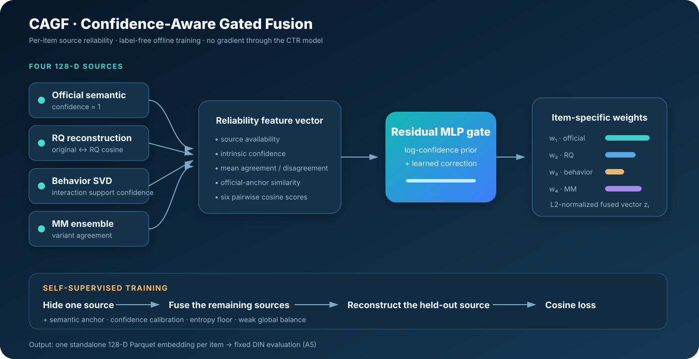

# CAGF: Confidence-Aware Gated Fusion

## 1. Motivation

The controlled Task 1 ablation shows that fixed four-source fusion (A4, 0.889229 AUC) underperforms the simpler RQ variant (A1, 0.895484). A single global weight vector assumes every source has the same reliability for every item, even though:

- behavior embeddings are less reliable for low-support items;
- multimodal variants may strongly disagree for visually or semantically ambiguous items;
- RQ reconstruction quality varies across the embedding space;
- a source can be missing or geometrically inconsistent with the others.

**CAGF** replaces global weights with a small offline gate that estimates source reliability for each item. It is a project-specific original extension; no claim of global algorithmic novelty or publication-level novelty is made before a broader literature review and external evaluation.



## 2. Inputs

For item \(i\), four normalized 128-D sources are stacked:

\[
E_i = [e_i^{official}, e_i^{RQ}, e_i^{behavior}, e_i^{MM}].
\]

The gate receives no user labels and no gradient from DIN or Transformer_DCN. It uses three groups of evidence:

1. **Intrinsic confidence**
   - official source: 1;
   - RQ: cosine agreement between original and reconstructed vectors;
   - behavior: robustly scaled interaction support (sequence frequency in the retained run);
   - MM ensemble: mean pairwise agreement among multimodal variants.
2. **Cross-source geometry**
   - per-source mean agreement and disagreement;
   - cosine similarity to the official semantic anchor;
   - all pairwise source cosine similarities.
3. **Availability mask**
   - missing sources are assigned zero probability before softmax.

## 3. Adaptive gate

Let \(\phi_i\) be the 26-dimensional confidence feature vector, \(c_i\) the intrinsic confidence vector, and \(m_i\) the availability mask. A two-layer residual gate produces:

\[
w_i = \operatorname{MaskedSoftmax}\left(\frac{g_\theta(\phi_i) + \log(c_i + \epsilon)}{\tau}, m_i\right).
\]

The fused embedding is:

\[
z_i = \operatorname{L2Norm}\left(\sum_s w_{i,s}e_i^s\right).
\]

The final layer is initialized to zero, so training starts from interpretable confidence-derived weights instead of random source selection.

## 4. Self-supervised leave-one-source-out objective

For each available source \(s\), CAGF removes it from the mixture and predicts it from the remaining sources:

\[
\hat e_i^{-s}=\operatorname{L2Norm}\left(
\sum_{r\ne s}\frac{w_{i,r}}{\sum_{q\ne s}w_{i,q}}e_i^r
\right).
\]

The primary loss is confidence-weighted cosine reconstruction:

\[
\mathcal L_{LOO}=\frac{\sum_{i,s}c_{i,s}
\left(1-\cos(\hat e_i^{-s},e_i^s)\right)}{\sum_{i,s}c_{i,s}}.
\]

Four regularizers stabilize the unsupervised gate:

- **semantic anchor:** keeps the fused vector near the official embedding;
- **confidence calibration:** aligns weights with intrinsic confidence and cross-source agreement;
- **entropy floor:** prevents premature one-source collapse;
- **batch balance:** weakly anchors mean usage to the former A4 prior while allowing item-level variation.

The full objective is:

\[
\mathcal L = \mathcal L_{LOO}
+ \lambda_a\mathcal L_{anchor}
+ \lambda_c\mathcal L_{calibration}
+ \lambda_e\mathcal L_{entropy}
+ \lambda_b\mathcal L_{balance}.
\]

## 5. Why it complies with Task 1

- It uses only challenge-provided embeddings and user behavior.
- It outputs one 128-D vector per item.
- It does not modify DIN.
- It does not consume CTR labels or backpropagate through the downstream CTR model.
- The gate is trained offline and materializes a Parquet artifact before DIN training.

## 6. Controlled evaluation

| Variant | Method | Status |
|---|---|---|
| A1 | official + RQ, equal global weights | Recorded: 0.895484 |
| A4 | four sources, fixed global weights | Recorded: 0.889229 |
| A5 | four sources, per-item CAGF weights | **Recorded: 0.891218** |

The A5 DIN configuration was generated by the same ablation runner. Seed, feature schema, DIN hyperparameters, early stopping, and data split were held fixed. A5 improved over fixed fusion A4 by 0.001989 AUC and over A0 by 0.024337, but remained 0.004266 below RQ-only A1. This is one recorded seed, so the A5–A4 difference is not presented as statistically significant.

The best checkpoint occurred at epoch 14. Later epochs became unstable and early stopping restored the best model. Its retained logloss is 2.254988, showing that stronger ranking AUC did not imply good probability calibration. The compact downstream record is retained in `results/cagf_A5_downstream.csv`; full logs and checkpoints remain outside the public repository because of size.

### Full-data gate diagnostics

The gate was trained offline on all 91,718 challenge items with seed `20242025`. These checks establish that A5 is a real adaptive representation, although they do not substitute for downstream AUC:

| Source | Available items | Mean weight | Across-item std | 5th–95th percentile |
|---|---:|---:|---:|---:|
| Official | 91,718 | 0.4294 | 0.0711 | 0.3223–0.5561 |
| RQ | 91,718 | 0.2276 | 0.0561 | 0.1418–0.3251 |
| Behavior | 91,297 | 0.0788 | 0.0200 | 0.0541–0.1159 |
| MM ensemble | 91,717 | 0.2643 | 0.0543 | 0.1745–0.3545 |

- 91,716 distinct weight vectors remain after rounding each weight to four decimals.
- All weights sum to 1 within floating-point tolerance.
- The 421 behavior-missing items and one MM-missing item receive exactly zero weight for the missing source.
- All 91,718 output vectors are finite and L2-normalized.

The retained evidence is in `results/cagf_A5_summary.json` and `results/cagf_A5_item_weights.parquet`.

## 7. Run

```bash
# Build only the A5 embedding and diagnostics
python scripts/build_ablation_embeddings.py --codes A5

# Focused fair comparison: RQ-only vs fixed fusion vs CAGF
bash scripts/run_cagf_ablation.sh 0
```

Outputs:

- `data/MicroLens_1M_x1/ablation/item_info_A5.parquet`
- `results/cagf_A5_item_weights.parquet`
- `results/cagf_A5_summary.json`
- `checkpoints/cagf_A5_gate.pt`
- generated DIN configuration in `config/ablation_A5/`

## 8. Acceptance criteria

Performance is evaluated on three independent axes:

1. **CTR utility:** A5 validation AUC versus A1 and A4.
2. **Adaptivity:** non-zero across-item weight standard deviation and different weight quantiles.
3. **Stability:** finite vectors, bounded weights, no missing IDs, and validation-loss early stopping.

A5 exceeded the fixed-weight four-source control but not the simpler RQ-only representation. The next controlled step is a multi-seed A1/A4/A5 comparison, followed by calibration-aware regularization or an objective better aligned with downstream ranking if the gap to A1 persists.
